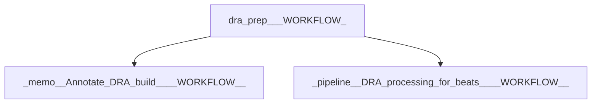

# dra-prep-pipeline

Buildkite pipeline definition for dra-prep-pipeline.

## At a glance

| | |
| --- | --- |
| Platform | Buildkite |
| Source | [`.buildkite/dra-prep-pipeline.yml`](../dra-prep-pipeline.yml) |
| Trigger | Not specified in this checked-in YAML; start conditions may be configured in Buildkite. |

## Purpose

This pipeline defines `:package: DRA Prep (${WORKFLOW})`, `:memo: Annotate DRA build (${WORKFLOW})`, `:pipeline: DRA processing for beats (${WORKFLOW})` for `dra-prep-pipeline`. The source does not state a separate motivation.

## When it runs

- Not specified in this checked-in YAML; start conditions may be configured in Buildkite.

## Execution flow

| Step | Condition | Depends on | Configured work |
| --- | --- | --- | --- |
| `:package: DRA Prep (${WORKFLOW})` | `No step condition declared` | None declared | Runs `.buildkite/scripts/stage-dra-artifacts.sh`; agents: provider=k8s; ephemeralStorage=80Gi; plugins: `elastic/oblt-google-auth#v1.3.1`, `elastic/dra-prep#v0.1.7`; artifacts: `artifacts/dra/beats/*/manifest-*.json` |
| `:memo: Annotate DRA build (${WORKFLOW})` | `build.env('DRY_RUN') != "true"` | dra-prep-${WORKFLOW} | Runs `.buildkite/scripts/dra-annotate.sh`; agents: provider=k8s; plugins: `elastic/oblt-google-auth#v1.3.1` |
| `:pipeline: DRA processing for beats (${WORKFLOW})` | `build.env('DRY_RUN') != "true"` | dra-prep-${WORKFLOW} | Triggers downstream pipeline `unified-release-dra-processing` |

## Inputs, outputs, and access

| Item | Details |
| --- | --- |
| Inputs | Environment names referenced: DRA_UPLOAD, DRA_WORKFLOW, STACK_VERSION, VERSION_QUALIFIER, WORKFLOW |
| Outputs | Artifact paths: `artifacts/dra/beats/*/manifest-*.json`; downstream pipelines: `unified-release-dra-processing` |
| Permissions | Agent requirements are configured per step (see table).; Plugins are configured per step (see table). |
| Secrets | No secret values are documented; named secret access is configured in referenced plugins or external Buildkite settings |

## Operational notes

- One or more steps declare an explicit timeout.

## Sources

- Pipeline definition: [`.buildkite/dra-prep-pipeline.yml`](../dra-prep-pipeline.yml)
- Referenced script: [`.buildkite/scripts/dra-annotate.sh`](../../.buildkite/scripts/dra-annotate.sh)
- Referenced script: [`.buildkite/scripts/stage-dra-artifacts.sh`](../../.buildkite/scripts/stage-dra-artifacts.sh)
