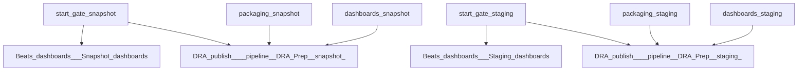

# packaging.pipeline

Buildkite pipeline definition for packaging.pipeline.

## At a glance

| | |
| --- | --- |
| Platform | Buildkite |
| Source | [`.buildkite/packaging.pipeline.yml`](../packaging.pipeline.yml) |
| Trigger | Not specified in this checked-in YAML; start conditions may be configured in Buildkite. |

## Purpose

This pipeline runs the configured `packaging.pipeline` work, organized into `Beats dashboards`, `Packaging snapshot`, `Packaging Staging`, `DRA publish`. The source does not state a separate motivation.

## When it runs

- Not specified in this checked-in YAML; start conditions may be configured in Buildkite.

## Execution flow

| Step | Condition | Depends on | Configured work |
| --- | --- | --- | --- |
| `Step` | `(build.branch =~ /^[0-9]+\.[0-9x]+\$/ \|\| build.branch == 'main' \|\| build.env('RUN_SNAPSHOT') == "true") && build.env('VERSION_QUALIFIER') == null` | None declared | Runs `echo "--> Start of concurrency gate dra-snapshot"` |
| `Step` | `build.branch =~ /^[0-9]+\.[0-9x]+\$/ \|\| build.env('VERSION_QUALIFIER') != null` | None declared | Runs `echo "--> Start of concurrency gate dra-staging"` |
| `Beats dashboards / Snapshot dashboards` | `(build.branch =~ /^[0-9]+\.[0-9x]+\$/ \|\| build.branch == 'main' \|\| build.env('RUN_SNAPSHOT') == "true") && build.env('VERSION_QUALIFIER') == null` | start-gate-snapshot | Configured step; agents: provider=gcp; image=${IMAGE_UBUNTU_X86_64}; machineType=${GCP_DEFAULT_MACHINE_TYPE}; plugins: `elastic/oblt-google-auth#v1.3.1`; artifacts: `build/distributions/**/*` |
| `Beats dashboards / Staging dashboards` | `(build.branch =~ /^[0-9]+\.[0-9x]+\$/ \|\| build.env('VERSION_QUALIFIER') != null) \|\| build.env('RUN_STAGING') == "true"` | start-gate-staging | Configured step; agents: provider=gcp; image=${IMAGE_UBUNTU_X86_64}; machineType=${GCP_DEFAULT_MACHINE_TYPE}; plugins: `elastic/oblt-google-auth#v1.3.1`; artifacts: `build/distributions/**/*` |
| `Packaging snapshot / SNAPSHOT: {{matrix}}` | `(build.branch =~ /^[0-9]+\.[0-9x]+\$/ \|\| build.branch == 'main' \|\| build.env('RUN_SNAPSHOT') == "true") && build.env('VERSION_QUALIFIER') == null` | None declared | Runs `.buildkite/scripts/packaging/package-dra.sh`; agents: provider=gcp; image=${IMAGE_UBUNTU_X86_64}; machineType=${GCP_DEFAULT_MACHINE_TYPE}; plugins: `elastic/oblt-google-auth#v1.3.1`, `elastic/vault-docker-login#v0.8.0`, `elastic/vault-docker-login#v0.8.0`; artifacts: `build/distributions/**/*` |
| `Packaging snapshot / SNAPSHOT: {{matrix}} Linux/arm64, Darwin/arm64, and Windows/arm64` | `(build.branch =~ /^[0-9]+\.[0-9x]+\$/ \|\| build.branch == 'main' \|\| build.env('RUN_SNAPSHOT') == "true") && build.env('VERSION_QUALIFIER') == null` | None declared | Runs `.buildkite/scripts/packaging/package-dra.sh`; agents: provider=aws; image=${AWS_IMAGE_UBUNTU_ARM_64}; instanceType=${AWS_ARM_INSTANCE_TYPE}; plugins: `elastic/oblt-google-auth#v1.3.1`, `elastic/vault-docker-login#v0.8.0`, `elastic/vault-docker-login#v0.8.0`; artifacts: `build/distributions/**/*` |
| `Packaging snapshot / SNAPSHOT: {{matrix}} Linux/amd64 and Windows/amd64 FIPS` | `(build.branch =~ /^[0-9]+\.[0-9x]+\$/ \|\| build.branch == 'main' \|\| build.env('RUN_SNAPSHOT') == "true") && build.env('VERSION_QUALIFIER') == null` | None declared | Runs `.buildkite/scripts/packaging/package-dra.sh`; agents: provider=gcp; image=${IMAGE_UBUNTU_X86_64}; machineType=${GCP_DEFAULT_MACHINE_TYPE}; plugins: `elastic/oblt-google-auth#v1.3.1`, `elastic/vault-docker-login#v0.8.0`, `elastic/vault-docker-login#v0.8.0`; artifacts: `build/distributions/**/*` |
| `Packaging snapshot / SNAPSHOT: {{matrix}} Linux/arm64 and Windows/arm64 FIPS` | `(build.branch =~ /^[0-9]+\.[0-9x]+\$/ \|\| build.branch == 'main' \|\| build.env('RUN_SNAPSHOT') == "true") && build.env('VERSION_QUALIFIER') == null` | None declared | Runs `.buildkite/scripts/packaging/package-dra.sh`; agents: provider=aws; image=${AWS_IMAGE_UBUNTU_ARM_64}; instanceType=${AWS_ARM_INSTANCE_TYPE}; plugins: `elastic/oblt-google-auth#v1.3.1`, `elastic/vault-docker-login#v0.8.0`, `elastic/vault-docker-login#v0.8.0`; artifacts: `build/distributions/**/*` |
| `Packaging Staging / STAGING: {{matrix}}` | `(build.branch =~ /^[0-9]+\.[0-9x]+\$/ \|\| build.env('VERSION_QUALIFIER') != null) \|\| build.env('RUN_STAGING') == "true"` | None declared | Runs `.buildkite/scripts/packaging/package-dra.sh`, `.buildkite/scripts/version_qualifier.sh`; agents: provider=gcp; image=${IMAGE_UBUNTU_X86_64}; machineType=${GCP_DEFAULT_MACHINE_TYPE}; plugins: `elastic/oblt-google-auth#v1.3.1`, `elastic/vault-docker-login#v0.8.0`, `elastic/vault-docker-login#v0.8.0`; artifacts: `build/distributions/**/*` |
| `Packaging Staging / STAGING: {{matrix}} Linux/arm64, Darwin/arm64, and Windows/arm64` | `(build.branch =~ /^[0-9]+\.[0-9x]+\$/ \|\| build.env('VERSION_QUALIFIER') != null) \|\| build.env('RUN_STAGING') == "true"` | None declared | Runs `.buildkite/scripts/packaging/package-dra.sh`, `.buildkite/scripts/version_qualifier.sh`; agents: provider=aws; image=${AWS_IMAGE_UBUNTU_ARM_64}; instanceType=${AWS_ARM_INSTANCE_TYPE}; plugins: `elastic/oblt-google-auth#v1.3.1`, `elastic/vault-docker-login#v0.8.0`, `elastic/vault-docker-login#v0.8.0`; artifacts: `build/distributions/**/*` |
| `Packaging Staging / STAGING: {{matrix}} Linux/amd64 and Windows/amd64 FIPS` | `(build.branch =~ /^[0-9]+\.[0-9x]+\$/ \|\| build.env('VERSION_QUALIFIER') != null) \|\| build.env('RUN_STAGING') == "true"` | None declared | Runs `.buildkite/scripts/packaging/package-dra.sh`, `.buildkite/scripts/version_qualifier.sh`; agents: provider=gcp; image=${IMAGE_UBUNTU_X86_64}; machineType=${GCP_DEFAULT_MACHINE_TYPE}; plugins: `elastic/oblt-google-auth#v1.3.1`, `elastic/vault-docker-login#v0.8.0`, `elastic/vault-docker-login#v0.8.0`; artifacts: `build/distributions/**/*` |
| `Packaging Staging / STAGING: {{matrix}} Linux/arm64 and Windows/arm64 FIPS` | `(build.branch =~ /^[0-9]+\.[0-9x]+\$/ \|\| build.env('VERSION_QUALIFIER') != null) \|\| build.env('RUN_STAGING') == "true"` | None declared | Runs `.buildkite/scripts/packaging/package-dra.sh`, `.buildkite/scripts/version_qualifier.sh`; agents: provider=aws; image=${AWS_IMAGE_UBUNTU_ARM_64}; instanceType=${AWS_ARM_INSTANCE_TYPE}; plugins: `elastic/oblt-google-auth#v1.3.1`, `elastic/vault-docker-login#v0.8.0`, `elastic/vault-docker-login#v0.8.0`; artifacts: `build/distributions/**/*` |
| `DRA publish / :pipeline: DRA Prep (snapshot)` | `(build.branch =~ /^[0-9]+\.[0-9x]+\$/ \|\| build.branch == 'main' \|\| build.env('RUN_SNAPSHOT') == "true") && build.env('VERSION_QUALIFIER') == null` | start-gate-snapshot, packaging-snapshot, dashboards-snapshot | Runs `.buildkite/scripts/packaging/resolve-dra-version.sh`; agents: provider=k8s |
| `DRA publish / :pipeline: DRA Prep (staging)` | `(build.branch =~ /^[0-9]+\.[0-9x]+\$/ \|\| build.env('VERSION_QUALIFIER') != null) \|\| build.env('RUN_STAGING') == "true"` | start-gate-staging, packaging-staging, dashboards-staging | Runs `.buildkite/scripts/packaging/resolve-dra-version.sh`; agents: provider=k8s |
| `Step` | `(build.branch =~ /^[0-9]+\.[0-9x]+\$/ \|\| build.branch == 'main' \|\| build.env('RUN_SNAPSHOT') == "true") && build.env('VERSION_QUALIFIER') == null` | None declared | Runs `echo "End of concurrency gate dra-snapshot <--"` |
| `Step` | `build.branch =~ /^[0-9]+\.[0-9x]+\$/ \|\| build.env('VERSION_QUALIFIER') != null` | None declared | Runs `echo "End of concurrency gate dra-staging <--"` |

## Inputs, outputs, and access

| Item | Details |
| --- | --- |
| Inputs | Environment names referenced: ASDF_MAGE_VERSION, AWS_ARM_INSTANCE_TYPE, AWS_IMAGE_UBUNTU_ARM_64, DEV, FIPS, GCP_DEFAULT_MACHINE_TYPE, IMAGE_UBUNTU_X86_64, PLATFORMS, PLATFORMS_AMD64_FIPS, PLATFORMS_ARM, PLATFORMS_ARM64_FIPS, SNAPSHOT, WORKFLOW |
| Outputs | Artifact paths: `build/distributions/**/*`; downstream pipelines: none declared |
| Permissions | Agent requirements are configured per step (see table).; Plugins are configured per step (see table). |
| Secrets | No secret values are documented; named secret access is configured in referenced plugins or external Buildkite settings |

## Operational notes

- This pipeline uploads [`.buildkite/dra-prep-pipeline.yml`](../dra-prep-pipeline.yml) for snapshot and staging DRA preparation. Those uploaded steps are defined in the linked pipeline file.
- One or more steps declare an explicit timeout.
- One or more steps declare automatic retry behavior.

## Sources

- Pipeline definition: [`.buildkite/packaging.pipeline.yml`](../packaging.pipeline.yml)
- Referenced script: [`.buildkite/scripts/packaging/package-dra.sh`](../../.buildkite/scripts/packaging/package-dra.sh)
- Referenced script: [`.buildkite/scripts/packaging/resolve-dra-version.sh`](../../.buildkite/scripts/packaging/resolve-dra-version.sh)
- Referenced script: [`.buildkite/scripts/version_qualifier.sh`](../../.buildkite/scripts/version_qualifier.sh)
- Dynamically uploaded pipeline: [`.buildkite/dra-prep-pipeline.yml`](../dra-prep-pipeline.yml)
- Referenced local dependency: [`.buildkite/scripts/docker.sh`](../../.buildkite/scripts/docker.sh)
