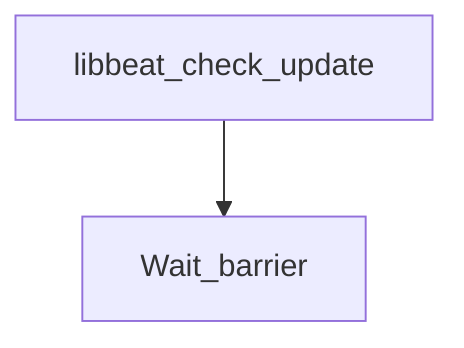

# beats-libbeat

Buildkite pipeline definition for beats-libbeat.

## At a glance

| | |
| --- | --- |
| Platform | Buildkite |
| Source | [`.buildkite/libbeat/pipeline.libbeat.yml`](../libbeat/pipeline.libbeat.yml) |
| Trigger | Not specified in this checked-in YAML; start conditions may be configured in Buildkite. |

## Purpose

This pipeline runs the configured `beats-libbeat` work, organized into `Check/Update`, `Mandatory Tests`, `Extended Tests`, `Extended Windows Tests`. The source does not state a separate motivation.

## When it runs

- Not specified in this checked-in YAML; start conditions may be configured in Buildkite.

## Execution flow

| Step | Condition | Depends on | Configured work |
| --- | --- | --- | --- |
| `Check/Update / Libbeat: Run check/update` | `No step condition declared` | None declared | Runs `make -C libbeat check update`; `make check-no-changes`; agents: image=${IMAGE_BEATS_WITH_HOOKS_LATEST}; cpu=4000m; memory=8Gi; useCustomGlobalHooks=true |
| `Check/Update / Libbeat: Run pre-commit` | `No step condition declared` | None declared | Runs `pre-commit run --all-files`; agents: image=${IMAGE_BEATS_WITH_HOOKS_LATEST}; memory=2Gi; useCustomGlobalHooks=true |
| `Wait barrier` | `build.env("BUILDKITE_PULL_REQUEST") != "false"` | libbeat-check-update | Waits at a Buildkite barrier |
| `Mandatory Tests / :ubuntu: Libbeat: Ubuntu x86_64 Unit Tests` | `No step condition declared` | None declared | Runs `cd libbeat`; `mage build unitTest`; agents: provider=gcp; image=${IMAGE_UBUNTU_X86_64}; machineType=${GCP_DEFAULT_MACHINE_TYPE}; plugins: `test-collector#v1.10.2`; artifacts: `libbeat/build/*.xml`, `libbeat/build/*.json` |
| `Mandatory Tests / :ubuntu: Libbeat: Ubuntu x86_64 Go Unit Tests with fips provider and requirefips build tag` | `No step condition declared` | None declared | Runs `cd libbeat`; `mage goUnitTest`; agents: provider=gcp; image=${IMAGE_UBUNTU_X86_64}; machineType=${GCP_DEFAULT_MACHINE_TYPE}; plugins: `test-collector#v1.10.2`; artifacts: `libbeat/build/*.xml`, `libbeat/build/*.json` |
| `Mandatory Tests / :ubuntu: Libbeat: Ubuntu x86_64 fips140=only Unit Tests` | `No step condition declared` | None declared | Runs `cd libbeat`; `mage goFIPSOnlyUnitTest`; agents: provider=gcp; image=${IMAGE_UBUNTU_X86_64}; machineType=${GCP_DEFAULT_MACHINE_TYPE}; plugins: `test-collector#v1.10.2`; artifacts: `libbeat/build/*.xml`, `libbeat/build/*.json` |
| `Mandatory Tests / :ubuntu: Libbeat: Go Integration Tests` | `No step condition declared` | None declared | Runs `cd libbeat`; `mage goIntegTest`; agents: provider=gcp; image=${IMAGE_UBUNTU_X86_64}; machineType=${GCP_HI_PERF_MACHINE_TYPE}; plugins: `test-collector#v1.10.2`; artifacts: `libbeat/build/*.xml`, `libbeat/build/*.json`, `libbeat/build/integration-tests/*`, `libbeat/build/integration-tests/Test*/*`, `libbeat/build/integration-tests/Test*/data/**/*` |
| `Mandatory Tests / :windows: Libbeat: Go Integration Tests` | `build.env("BUILDKITE_PULL_REQUEST") != "false"` | None declared | Runs `cd libbeat`; `mage goIntegTest`; agents: provider=gcp; image=${IMAGE_WIN_2022}; machine_type=${GCP_WIN_MACHINE_TYPE}; disk_size=200; disk_type=pd-ssd; plugins: `test-collector#v1.10.2`; artifacts: `libbeat/build/*.xml`, `libbeat/build/*.json`, `libbeat/build/integration-tests/*`, `libbeat/build/integration-tests/Test*/*`, `libbeat/build/integration-tests/Test*/data/**/*`; skipped: Skipped due to https://github.com/elastic/beats/issues/44537 |
| `Mandatory Tests / :ubuntu: Libbeat: Stress Tests` | `No step condition declared` | None declared | Runs `cd libbeat`; `make STRESS_TEST_OPTIONS='-timeout=20m -race -v -parallel 1' GOTEST_OUTPUT_OPTIONS=' | go-junit-rep…`; agents: provider=gcp; image=${IMAGE_UBUNTU_X86_64}; machineType=${GCP_DEFAULT_MACHINE_TYPE}; artifacts: `libbeat/libbeat-stress-test.xml` |
| `Mandatory Tests / :windows: Libbeat: Win 2016 Unit Tests` | `No step condition declared` | None declared | Runs `Set-Location -Path libbeat`; `mage -w reader\etw build goUnitTest`; agents: provider=gcp; image=${IMAGE_WIN_2016}; machine_type=${GCP_WIN_MACHINE_TYPE}; disk_size=100; disk_type=pd-ssd; artifacts: `libbeat/build/*.xml`, `libbeat/build/*.json` |
| `Mandatory Tests / :windows: Libbeat: Win 2022 Unit Tests` | `No step condition declared` | None declared | Runs `Set-Location -Path libbeat`; `mage -w reader\etw build goUnitTest`; agents: provider=gcp; image=${IMAGE_WIN_2022}; machine_type=${GCP_WIN_MACHINE_TYPE}; disk_size=100; disk_type=pd-ssd; artifacts: `libbeat/build/*.xml`, `libbeat/build/*.json` |
| `Extended Tests / :ubuntu: Libbeat: Ubuntu arm64 Unit Tests` | `build.env("BUILDKITE_PULL_REQUEST") == "false" \|\| build.env("GITHUB_PR_LABELS") =~ /.*arm.*/` | None declared | Runs `cd libbeat`; `mage build unitTest`; agents: provider=aws; image=${AWS_IMAGE_UBUNTU_ARM_64}; instanceType=${AWS_ARM_INSTANCE_TYPE}; plugins: `test-collector#v1.10.2`; artifacts: `libbeat/build/*.xml`, `libbeat/build/*.json` |
| `Extended Windows Tests / :windows: Libbeat: Win 10 Unit Tests` | `build.env("BUILDKITE_PULL_REQUEST") == "false" \|\| build.env("GITHUB_PR_LABELS") =~ /.*[Ww]indows.*/` | None declared | Runs `Set-Location -Path libbeat`; `mage -w reader\etw build goUnitTest`; agents: provider=azure; image=${IMAGE_WIN_10}; imageVersion=${IMAGE_WIN_10_VERSION}; vmSize=Standard_D8s_v5; diskSizeGb=256; artifacts: `libbeat/build/*.xml`, `libbeat/build/*.json` |
| `Extended Windows Tests / :windows: Libbeat: Win 11 Unit Tests` | `build.env("BUILDKITE_PULL_REQUEST") == "false" \|\| build.env("GITHUB_PR_LABELS") =~ /.*[Ww]indows.*/` | None declared | Runs `Set-Location -Path libbeat`; `mage -w reader\etw build goUnitTest`; agents: provider=azure; image=${IMAGE_WIN_11}; imageVersion=${IMAGE_WIN_11_VERSION}; vmSize=Standard_D8s_v5; diskSizeGb=256; artifacts: `libbeat/build/*.xml`, `libbeat/build/*.json` |
| `Extended Windows Tests / :windows: Libbeat: Win 2019 Unit Tests` | `build.env("BUILDKITE_PULL_REQUEST") == "false" \|\| build.env("GITHUB_PR_LABELS") =~ /.*[Ww]indows.*/` | None declared | Runs `Set-Location -Path libbeat`; `mage -w reader\etw build goUnitTest`; agents: provider=gcp; image=${IMAGE_WIN_2019}; machineType=${GCP_WIN_MACHINE_TYPE}; disk_size=100; disk_type=pd-ssd; artifacts: `libbeat/build/*.xml`, `libbeat/build/*.json` |

## Inputs, outputs, and access

| Item | Details |
| --- | --- |
| Inputs | Environment names referenced: ASDF_MAGE_VERSION, AWS_ARM_INSTANCE_TYPE, AWS_IMAGE_UBUNTU_ARM_64, FIPS, GCP_DEFAULT_MACHINE_TYPE, GCP_HI_PERF_MACHINE_TYPE, GCP_WIN_MACHINE_TYPE, IMAGE_BEATS_WITH_HOOKS_LATEST, IMAGE_UBUNTU_X86_64, IMAGE_WIN_10, IMAGE_WIN_10_VERSION, IMAGE_WIN_11, IMAGE_WIN_11_VERSION, IMAGE_WIN_2016, IMAGE_WIN_2019, IMAGE_WIN_2022, RACE_DETECTOR, TEST_COVERAGE |
| Outputs | Artifact paths: `libbeat/build/*.json`, `libbeat/build/*.xml`, `libbeat/build/integration-tests/*`, `libbeat/build/integration-tests/Test*/*`, `libbeat/build/integration-tests/Test*/data/**/*`, `libbeat/libbeat-stress-test.xml`; downstream pipelines: none declared |
| Permissions | Agent requirements are configured per step (see table).; Plugins are configured per step (see table). |
| Secrets | No secret values are documented; named secret access is configured in referenced plugins or external Buildkite settings |

## Operational notes

- One or more steps declare automatic retry behavior.

## Sources

- Pipeline definition: [`.buildkite/libbeat/pipeline.libbeat.yml`](../libbeat/pipeline.libbeat.yml)
