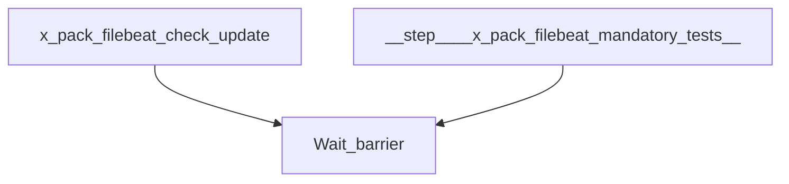

# beats-xpack-filebeat

Buildkite pipeline definition for beats-xpack-filebeat.

## At a glance

| | |
| --- | --- |
| Platform | Buildkite |
| Source | [`.buildkite/x-pack/pipeline.xpack.filebeat.yml`](../x-pack/pipeline.xpack.filebeat.yml) |
| Trigger | Not specified in this checked-in YAML; start conditions may be configured in Buildkite. |

## Purpose

This pipeline runs the configured `beats-xpack-filebeat` work, organized into `Check/Update`, `Mandatory Tests`, `Extended Windows Tests`, `Extended Tests`, `Packaging`. The source does not state a separate motivation.

## When it runs

- Not specified in this checked-in YAML; start conditions may be configured in Buildkite.

## Execution flow

| Step | Condition | Depends on | Configured work |
| --- | --- | --- | --- |
| `Check/Update / x-pack/filebeat: Run check/update` | `No step condition declared` | None declared | Runs `make -C x-pack/filebeat check update`; `make check-no-changes`; agents: image=${IMAGE_BEATS_WITH_HOOKS_LATEST}; cpu=4000m; memory=8Gi; useCustomGlobalHooks=true |
| `Check/Update / x-pack/filebeat: Run pre-commit` | `No step condition declared` | None declared | Runs `pre-commit run --all-files`; agents: image=${IMAGE_BEATS_WITH_HOOKS_LATEST}; memory=2Gi; useCustomGlobalHooks=true |
| `Wait barrier` | `build.env("BUILDKITE_PULL_REQUEST") != "false"` | x-pack-filebeat-check-update | Waits at a Buildkite barrier |
| `Mandatory Tests / :ubuntu: x-pack/filebeat: Ubuntu x86_64 Unit Tests` | `No step condition declared` | None declared | Runs `cd x-pack/filebeat`; `mage build unitTest`; agents: provider=gcp; image=${IMAGE_UBUNTU_X86_64}; machineType=${GCP_DEFAULT_MACHINE_TYPE}; plugins: `test-collector#v1.10.2`; artifacts: `x-pack/filebeat/build/*.xml`, `x-pack/filebeat/build/*.json` |
| `Mandatory Tests / :ubuntu: x-pack/filebeat: Ubuntu x86_64 Unit Tests with requirefips build tag` | `No step condition declared` | None declared | Runs `cd x-pack/filebeat`; `mage unitTest`; agents: provider=gcp; image=${IMAGE_UBUNTU_X86_64}; machineType=${GCP_DEFAULT_MACHINE_TYPE}; plugins: `test-collector#v1.10.2`; artifacts: `x-pack/filebeat/build/*.xml`, `x-pack/filebeat/build/*.json` |
| `Mandatory Tests / :ubuntu: x-pack/filebeat: Ubuntu x86_64 fips140=only Unit Tests` | `No step condition declared` | None declared | Runs `cd x-pack/filebeat`; `mage goFIPSOnlyUnitTest`; agents: provider=gcp; image=${IMAGE_UBUNTU_X86_64}; machineType=${GCP_DEFAULT_MACHINE_TYPE}; plugins: `test-collector#v1.10.2`; artifacts: `x-pack/filebeat/build/*.xml`, `x-pack/filebeat/build/*.json` |
| `Mandatory Tests / :ubuntu: x-pack/filebeat: Go Integration Tests` | `No step condition declared` | None declared | Runs `cd x-pack/filebeat`; `mage goIntegTest`; agents: provider=gcp; image=${IMAGE_UBUNTU_X86_64}; machineType=${GCP_DEFAULT_MACHINE_TYPE}; plugins: `test-collector#v1.10.2`; artifacts: `x-pack/filebeat/build/*.xml`, `x-pack/filebeat/build/*.json`, `x-pack/filebeat/build/input-test/**`, `x-pack/filebeat/build/integration-tests/**` |
| `Mandatory Tests / :ubuntu: x-pack/filebeat: Go fips140=only Integration Tests` | `No step condition declared` | None declared | Runs `cd x-pack/filebeat`; `mage goFIPSOnlyIntegTest`; agents: provider=gcp; image=${IMAGE_UBUNTU_X86_64}; machineType=${GCP_DEFAULT_MACHINE_TYPE}; plugins: `test-collector#v1.10.2`; artifacts: `x-pack/filebeat/build/*.xml`, `x-pack/filebeat/build/*.json`, `x-pack/filebeat/build/input-test/**`, `x-pack/filebeat/build/integration-tests/**` |
| `Mandatory Tests / :ubuntu: x-pack/filebeat: FIPS ECH Integration Tests` | `No step condition declared` | None declared | Runs `.buildkite/scripts/custom_fips_ech_test.sh`; agents: provider=gcp; image=${IMAGE_UBUNTU_X86_64}; machineType=${GCP_DEFAULT_MACHINE_TYPE}; plugins: `test-collector#v1.10.2`, `elastic/vault-secrets#v0.1.0`; artifacts: `x-pack/filebeat/build/*.xml`, `x-pack/filebeat/build/*.json`, `x-pack/filebeat/build/input-test/**`, `x-pack/filebeat/build/integration-tests/**` |
| `Mandatory Tests / :ubuntu: x-pack/filebeat: Python Integration Tests` | `No step condition declared` | None declared | Runs `cd x-pack/filebeat`; `mage pythonIntegTest`; agents: provider=gcp; image=${IMAGE_UBUNTU_X86_64}; machineType=${GCP_DEFAULT_MACHINE_TYPE}; plugins: `test-collector#v1.10.2`; artifacts: `x-pack/filebeat/build/*.xml`, `x-pack/filebeat/build/*.json`, `x-pack/filebeat/build/input-test/**`, `x-pack/filebeat/build/integration-tests/**` |
| `Mandatory Tests / :windows: x-pack/filebeat: Go Windows Integration Tests` | `No step condition declared` | None declared | Runs `cd x-pack/filebeat`; `mage goWindowsIntegTest`; agents: provider=gcp; image=${IMAGE_WIN_2022}; machineType=${GCP_WIN_MACHINE_TYPE}; plugins: `test-collector#v1.10.2`; artifacts: `x-pack/filebeat/build/*.xml`, `x-pack/filebeat/build/*.json`, `x-pack/filebeat/build/input-test/**`, `x-pack/filebeat/build/integration-tests/**` |
| `Mandatory Tests / :windows: x-pack/filebeat: Win 2022 Unit Tests` | `No step condition declared` | None declared | Runs `Set-Location -Path x-pack/filebeat`; `mage build unitTest`; agents: provider=gcp; image=${IMAGE_WIN_2022}; machine_type=${GCP_WIN_MACHINE_TYPE}; disk_size=100; disk_type=pd-ssd; plugins: `test-collector#v1.10.2`; artifacts: `x-pack/filebeat/build/*.xml`, `x-pack/filebeat/build/*.json` |
| `Mandatory Tests / :windows: x-pack/filebeat: Win 2016 Unit Tests` | `No step condition declared` | None declared | Runs `Set-Location -Path x-pack/filebeat`; `mage build unitTest`; agents: provider=gcp; image=${IMAGE_WIN_2016}; machine_type=${GCP_WIN_MACHINE_TYPE}; disk_size=100; disk_type=pd-ssd; plugins: `test-collector#v1.10.2`; artifacts: `x-pack/filebeat/build/*.xml`, `x-pack/filebeat/build/*.json` |
| `Extended Windows Tests / :windows: x-pack/filebeat: Win 2019 Unit Tests` | `build.env("BUILDKITE_PULL_REQUEST") == "false" \|\| build.env("GITHUB_PR_LABELS") =~ /.*[Ww]indows.*/` | None declared | Runs `Set-Location -Path x-pack/filebeat`; `mage build unitTest`; agents: provider=gcp; image=${IMAGE_WIN_2019}; machineType=${GCP_WIN_MACHINE_TYPE}; disk_size=100; disk_type=pd-ssd; plugins: `test-collector#v1.10.2`; artifacts: `x-pack/filebeat/build/*.xml`, `x-pack/filebeat/build/*.json` |
| `Extended Windows Tests / :windows: x-pack/filebeat: Win 10 Unit Tests` | `build.env("BUILDKITE_PULL_REQUEST") == "false" \|\| build.env("GITHUB_PR_LABELS") =~ /.*[Ww]indows.*/` | None declared | Runs `Set-Location -Path x-pack/filebeat`; `mage build unitTest`; agents: provider=azure; image=${IMAGE_WIN_10}; imageVersion=${IMAGE_WIN_10_VERSION}; vmSize=Standard_D8s_v5; diskSizeGb=256; plugins: `test-collector#v1.10.2`; artifacts: `x-pack/filebeat/build/*.xml`, `x-pack/filebeat/build/*.json` |
| `Extended Windows Tests / :windows: x-pack/filebeat: Win 11 Unit Tests` | `build.env("BUILDKITE_PULL_REQUEST") == "false" \|\| build.env("GITHUB_PR_LABELS") =~ /.*[Ww]indows.*/` | None declared | Runs `Set-Location -Path x-pack/filebeat`; `mage build unitTest`; agents: provider=azure; image=${IMAGE_WIN_11}; imageVersion=${IMAGE_WIN_11_VERSION}; vmSize=Standard_D8s_v5; diskSizeGb=256; plugins: `test-collector#v1.10.2`; artifacts: `x-pack/filebeat/build/*.xml`, `x-pack/filebeat/build/*.json` |
| `Extended Tests / :ubuntu: x-pack/filebeat: Ubuntu arm64 Unit Tests` | `build.env("BUILDKITE_PULL_REQUEST") == "false" \|\| build.env("GITHUB_PR_LABELS") =~ /.*arm.*/` | None declared | Runs `cd x-pack/filebeat`; `mage build unitTest`; agents: provider=aws; image=${AWS_IMAGE_UBUNTU_ARM_64}; instanceType=${AWS_ARM_INSTANCE_TYPE}; plugins: `test-collector#v1.10.2`; artifacts: `x-pack/filebeat/build/*.xml`, `x-pack/filebeat/build/*.json` |
| `Extended Tests / :ubuntu: x-pack/filebeat: AWS Tests` | `build.env("GITHUB_PR_LABELS") =~ /.*aws.*/` | None declared | Runs `.buildkite/scripts/initCloudEnv.sh`; agents: provider=aws; image=${AWS_IMAGE_UBUNTU_ARM_64}; instanceType=${AWS_ARM_INSTANCE_TYPE}; plugins: `test-collector#v1.10.2`, `elastic/oblt-aws-auth#v0.2.0`; artifacts: `x-pack/filebeat/build/*.xml`, `x-pack/filebeat/build/*.json`; skipped: skipping: elastic/ingest-dev#3467 |
| `Wait barrier` | `build.env("BUILDKITE_PULL_REQUEST") != "false"` | {'step': 'x-pack-filebeat-mandatory-tests'} | Waits at a Buildkite barrier |
| `Packaging / :linux: x-pack/filebeat: Packaging Linux` | `build.pull_request.id != null` | None declared | Runs `.buildkite/scripts/packaging/packaging.sh`; agents: provider=gcp; image=${IMAGE_UBUNTU_X86_64}; machineType=${GCP_HI_PERF_MACHINE_TYPE}; disk_size=100; disk_type=pd-ssd; plugins: `elastic/vault-docker-login#v0.8.0`, `elastic/vault-docker-login#v0.8.0` |
| `Packaging / :linux: x-pack/filebeat: Packaging arm64` | `build.pull_request.id != null` | None declared | Runs `.buildkite/scripts/packaging/packaging.sh`; agents: provider=aws; image=${AWS_IMAGE_UBUNTU_ARM_64}; instanceType=${AWS_ARM_INSTANCE_TYPE}; plugins: `elastic/vault-docker-login#v0.8.0`, `elastic/vault-docker-login#v0.8.0` |
| `Packaging / :linux: x-pack/filebeat: Packaging Linux amd64 FIPS` | `build.pull_request.id != null` | None declared | Runs `.buildkite/scripts/packaging/packaging.sh`; agents: provider=gcp; image=${IMAGE_UBUNTU_X86_64}; machineType=${GCP_HI_PERF_MACHINE_TYPE}; disk_size=100; disk_type=pd-ssd; plugins: `elastic/vault-docker-login#v0.8.0`, `elastic/vault-docker-login#v0.8.0` |
| `Packaging / :linux: x-pack/filebeat: Packaging Linux arm64 FIPS` | `build.pull_request.id != null` | None declared | Runs `.buildkite/scripts/packaging/packaging.sh`; agents: provider=aws; image=${AWS_IMAGE_UBUNTU_ARM_64}; instanceType=${AWS_ARM_INSTANCE_TYPE}; plugins: `elastic/vault-docker-login#v0.8.0`, `elastic/vault-docker-login#v0.8.0` |
| `Packaging / :windows: x-pack/filebeat: Packaging Windows amd64 FIPS` | `build.pull_request.id != null` | None declared | Runs `.buildkite/scripts/packaging/packaging.sh`; agents: provider=gcp; image=${IMAGE_UBUNTU_X86_64}; machineType=${GCP_HI_PERF_MACHINE_TYPE}; disk_size=100; disk_type=pd-ssd; plugins: `elastic/vault-docker-login#v0.8.0`, `elastic/vault-docker-login#v0.8.0` |
| `Packaging / :windows: x-pack/filebeat: Packaging Windows arm64 FIPS` | `build.pull_request.id != null` | None declared | Runs `.buildkite/scripts/packaging/packaging.sh`; agents: provider=aws; image=${AWS_IMAGE_UBUNTU_ARM_64}; instanceType=${AWS_ARM_INSTANCE_TYPE}; plugins: `elastic/vault-docker-login#v0.8.0`, `elastic/vault-docker-login#v0.8.0` |

## Inputs, outputs, and access

| Item | Details |
| --- | --- |
| Inputs | Environment names referenced: ASDF_MAGE_VERSION, ASDF_TERRAFORM_VERSION, AWS_ARM_INSTANCE_TYPE, AWS_IMAGE_UBUNTU_ARM_64, FIPS, GCP_DEFAULT_MACHINE_TYPE, GCP_HI_PERF_MACHINE_TYPE, GCP_WIN_MACHINE_TYPE, IMAGE_BEATS_WITH_HOOKS_LATEST, IMAGE_UBUNTU_X86_64, IMAGE_WIN_10, IMAGE_WIN_10_VERSION, IMAGE_WIN_11, IMAGE_WIN_11_VERSION, IMAGE_WIN_2016, IMAGE_WIN_2019, IMAGE_WIN_2022, MODULE, MODULE_DIR, PLATFORMS, PLATFORMS_AMD64_FIPS, PLATFORMS_ARM64_FIPS, PYTEST_ADDOPTS, RACE_DETECTOR, TEST_COVERAGE, TEST_TAGS, TF_VAR_ech_region |
| Outputs | Artifact paths: `x-pack/filebeat/build/*.json`, `x-pack/filebeat/build/*.xml`, `x-pack/filebeat/build/input-test/**`, `x-pack/filebeat/build/integration-tests/**`; downstream pipelines: none declared |
| Permissions | Agent requirements are configured per step (see table).; Plugins are configured per step (see table). |
| Secrets | No secret values are documented; named secret access is configured in referenced plugins or external Buildkite settings |

## Operational notes

- One or more steps declare an explicit timeout.
- One or more steps declare automatic retry behavior.

## Sources

- Pipeline definition: [`.buildkite/x-pack/pipeline.xpack.filebeat.yml`](../x-pack/pipeline.xpack.filebeat.yml)
- Referenced script: [`.buildkite/scripts/custom_fips_ech_test.sh`](../../.buildkite/scripts/custom_fips_ech_test.sh)
- Referenced script: [`.buildkite/scripts/initCloudEnv.sh`](../../.buildkite/scripts/initCloudEnv.sh)
- Referenced script: [`.buildkite/scripts/packaging/packaging.sh`](../../.buildkite/scripts/packaging/packaging.sh)
- Referenced local dependency: [`.buildkite/deploy/docker/docker-compose.yml`](../../.buildkite/deploy/docker/docker-compose.yml)
- Referenced local dependency: [`.buildkite/scripts/docker.sh`](../../.buildkite/scripts/docker.sh)
- Referenced local dependency: [`.buildkite/scripts/ech.sh`](../../.buildkite/scripts/ech.sh)
- Referenced local dependency: [`.buildkite/scripts/qemu.sh`](../../.buildkite/scripts/qemu.sh)
