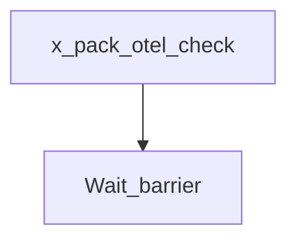

# beats-xpack-otel

Buildkite pipeline definition for beats-xpack-otel.

## At a glance

| | |
| --- | --- |
| Platform | Buildkite |
| Source | [`.buildkite/x-pack/pipeline.xpack.otel.yml`](../x-pack/pipeline.xpack.otel.yml) |
| Trigger | Not specified in this checked-in YAML; start conditions may be configured in Buildkite. |

## Purpose

This pipeline runs the configured `beats-xpack-otel` work, organized into `check`, `Mandatory Tests`, `Extended Tests`. The source does not state a separate motivation.

## When it runs

- Not specified in this checked-in YAML; start conditions may be configured in Buildkite.

## Execution flow

| Step | Condition | Depends on | Configured work |
| --- | --- | --- | --- |
| `check / x-pack/otel: Run check` | `No step condition declared` | None declared | Runs `make -C x-pack/otel check`; `make check-no-changes`; agents: image=${IMAGE_BEATS_WITH_HOOKS_LATEST}; cpu=4000m; memory=12Gi; ephemeralStorage=50G; useCustomGlobalHooks=true |
| `Wait barrier` | `build.env("BUILDKITE_PULL_REQUEST") != "false"` | x-pack-otel-check | Waits at a Buildkite barrier |
| `Mandatory Tests / :ubuntu: x-pack/otel: Build OTel Collector Distribution` | `No step condition declared` | None declared | Runs `make -C x-pack/otel build-otel-distro-ci`; agents: provider=gcp; image=${IMAGE_UBUNTU_X86_64}; machineType=${GCP_DEFAULT_MACHINE_TYPE} |
| `Mandatory Tests / :ubuntu: x-pack/otel: Ubuntu x86_64 Unit Tests` | `No step condition declared` | None declared | Runs `cd x-pack/otel`; `mage goUnitTest`; agents: provider=gcp; image=${IMAGE_UBUNTU_X86_64}; machineType=${GCP_DEFAULT_MACHINE_TYPE}; plugins: `test-collector#v1.11.0`; artifacts: `x-pack/otel/build/*.xml`, `x-pack/otel/build/*.json` |
| `Extended Tests / :ubuntu: x-pack/otel: Ubuntu arm64 Unit Tests` | `build.env("BUILDKITE_PULL_REQUEST") == "false" \|\| build.env("GITHUB_PR_LABELS") =~ /.*arm.*/` | None declared | Runs `cd x-pack/otel`; `mage goUnitTest`; agents: provider=aws; image=${AWS_IMAGE_UBUNTU_ARM_64}; instanceType=${AWS_ARM_INSTANCE_TYPE}; artifacts: `x-pack/otel/build/*.xml`, `x-pack/otel/build/*.json` |

## Inputs, outputs, and access

| Item | Details |
| --- | --- |
| Inputs | Environment names referenced: ASDF_MAGE_VERSION, AWS_ARM_INSTANCE_TYPE, AWS_IMAGE_UBUNTU_ARM_64, GCP_DEFAULT_MACHINE_TYPE, IMAGE_BEATS_WITH_HOOKS_LATEST, IMAGE_UBUNTU_X86_64, RACE_DETECTOR, TEST_COVERAGE |
| Outputs | Artifact paths: `x-pack/otel/build/*.json`, `x-pack/otel/build/*.xml`; downstream pipelines: none declared |
| Permissions | Agent requirements are configured per step (see table).; Plugins are configured per step (see table). |
| Secrets | No secret values are documented; named secret access is configured in referenced plugins or external Buildkite settings |

## Operational notes

- One or more steps declare automatic retry behavior.

## Sources

- Pipeline definition: [`.buildkite/x-pack/pipeline.xpack.otel.yml`](../x-pack/pipeline.xpack.otel.yml)
