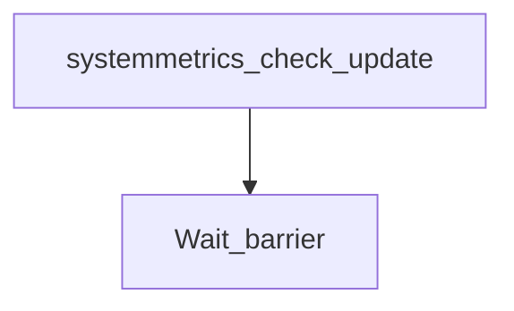

# beats-pkg-systemmetrics

Buildkite pipeline definition for beats-pkg-systemmetrics.

## At a glance

| | |
| --- | --- |
| Platform | Buildkite |
| Source | [`.buildkite/pkg/systemmetrics/pipeline.yml`](../pkg/systemmetrics/pipeline.yml) |
| Trigger | Not specified in this checked-in YAML; start conditions may be configured in Buildkite. |

## Purpose

This pipeline runs the configured `beats-pkg-systemmetrics` work, organized into `Check/Update`, `Mandatory Tests`. The source does not state a separate motivation.

## When it runs

- Not specified in this checked-in YAML; start conditions may be configured in Buildkite.
- The top-level component triggers require a pull request and use `if_changed` include patterns. A separate serverless-beats trigger is conditioned on not being a pull request.

## Execution flow

| Step | Condition | Depends on | Configured work |
| --- | --- | --- | --- |
| `Check/Update / pkg/systemmetrics: Run check` | `No step condition declared` | None declared | Runs `make -C pkg/systemmetrics check`; `make check-no-changes`; agents: image=${IMAGE_BEATS_WITH_HOOKS_LATEST}; cpu=4000m; memory=8Gi; useCustomGlobalHooks=true |
| `Wait barrier` | `build.env("BUILDKITE_PULL_REQUEST") != "false"` | systemmetrics-check-update | Waits at a Buildkite barrier |
| `Mandatory Tests / :ubuntu: pkg/systemmetrics: Ubuntu x86_64 Unit Tests` | `No step condition declared` | None declared | Runs `cd pkg/systemmetrics`; `mage goUnitTest`; agents: provider=gcp; image=${IMAGE_UBUNTU_X86_64}; machineType=${GCP_DEFAULT_MACHINE_TYPE}; plugins: `test-collector#v1.10.2`; artifacts: `pkg/systemmetrics/build/*.xml`, `pkg/systemmetrics/build/*.json` |
| `Mandatory Tests / :windows: pkg/systemmetrics: Win 2022 Unit Tests` | `No step condition declared` | None declared | Runs `Set-Location -Path pkg\systemmetrics`; `mage goUnitTest`; agents: provider=gcp; image=${IMAGE_WIN_2022}; machine_type=${GCP_WIN_MACHINE_TYPE}; disk_size=100; disk_type=pd-ssd; artifacts: `pkg/systemmetrics/build/*.xml`, `pkg/systemmetrics/build/*.json` |
| `Mandatory Tests / :linux: pkg/systemmetrics: Container-System Tests -- {{matrix.image}}` | `No step condition declared` | None declared | Runs `cd pkg/systemmetrics`; `mage goIntegTest`; agents: provider=gcp; image={{matrix.image}}; machineType=${GCP_DEFAULT_MACHINE_TYPE}; plugins: `test-collector#v1.10.2`; artifacts: `pkg/systemmetrics/build/*.xml`, `pkg/systemmetrics/build/*.json` |

## Inputs, outputs, and access

| Item | Details |
| --- | --- |
| Inputs | Environment names referenced: ASDF_MAGE_VERSION, GCP_DEFAULT_MACHINE_TYPE, GCP_WIN_MACHINE_TYPE, HOST_OS_IMAGE, IMAGE_BEATS_WITH_HOOKS_LATEST, IMAGE_RHEL9_X86_64, IMAGE_UBUNTU_2004_X86_64, IMAGE_UBUNTU_X86_64, IMAGE_WIN_2022, RACE_DETECTOR, TEST_COVERAGE |
| Outputs | Artifact paths: `pkg/systemmetrics/build/*.json`, `pkg/systemmetrics/build/*.xml`; downstream pipelines: none declared |
| Permissions | Agent requirements are configured per step (see table).; Plugins are configured per step (see table). |
| Secrets | No secret values are documented; named secret access is configured in referenced plugins or external Buildkite settings |

## Operational notes

- One or more steps declare automatic retry behavior.
- The root pipeline conditionally uploads component builds based on changed paths; downstream test/package behavior is defined in the referenced pipeline YAML files.

## Sources

- Pipeline definition: [`.buildkite/pkg/systemmetrics/pipeline.yml`](../pkg/systemmetrics/pipeline.yml)
