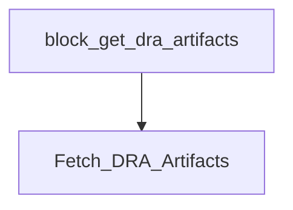

# version-bump-pipeline

Buildkite pipeline definition for version-bump-pipeline.

## At a glance

| | |
| --- | --- |
| Platform | Buildkite |
| Source | [`.buildkite/version-bump-pipeline.yml`](../version-bump-pipeline.yml) |
| Trigger | Not specified in this checked-in YAML; start conditions may be configured in Buildkite. |

## Purpose

This pipeline defines `:rocket: Trigger ingest-dev minor/major release`, `:rocket: Trigger ingest-dev patch release`, `Fetch DRA Artifacts` for `version-bump-pipeline`. The source does not state a separate motivation.

## When it runs

- Not specified in this checked-in YAML; start conditions may be configured in Buildkite.

## Execution flow

| Step | Condition | Depends on | Configured work |
| --- | --- | --- | --- |
| `:rocket: Trigger ingest-dev minor/major release` | `build.env("WORKFLOW") == "minor" \|\| build.env("WORKFLOW") == "major"` | None declared | Triggers downstream pipeline `ingest-dev-pipeline-release-minor-major` |
| `:rocket: Trigger ingest-dev patch release` | `build.env("WORKFLOW") == "patch"` | None declared | Triggers downstream pipeline `ingest-dev-pipeline-release-patch` |
| `Step` | `No step condition declared` | None declared | Configured step |
| `Fetch DRA Artifacts` | `No step condition declared` | block-get-dra-artifacts | Configured step; agents: image=docker.elastic.co/release-eng/wolfi-build-essenti…; cpu=250m; memory=512Mi; ephemeralStorage=1Gi; plugins: `elastic/version-bump-dra#v1.0.0` |

## Inputs, outputs, and access

| Item | Details |
| --- | --- |
| Inputs | Environment names referenced: BRANCH, BUILDKITE_BUILD_URL, NEW_VERSION, REPO, WORKFLOW |
| Outputs | Artifact paths: none declared in this file; downstream pipelines: `ingest-dev-pipeline-release-minor-major`, `ingest-dev-pipeline-release-patch` |
| Permissions | Agent requirements are configured per step (see table).; Plugins are configured per step (see table). |
| Secrets | No secret values are documented; named secret access is configured in referenced plugins or external Buildkite settings |

## Operational notes

- One or more steps declare an explicit timeout.
- One or more steps declare automatic retry behavior.

## Sources

- Pipeline definition: [`.buildkite/version-bump-pipeline.yml`](../version-bump-pipeline.yml)
