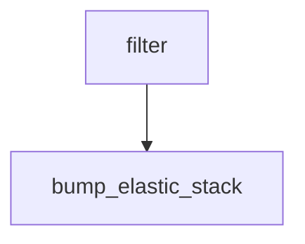

# bump-elastic-stack-snapshot

Workflow definition for **bump-elastic-stack-snapshot**. This page documents the checked-in GitHub Actions configuration; it does not assert that a run succeeds.

## At a glance

| | |
| --- | --- |
| Platform | GitHub Actions |
| Source | [`.github/workflows/bump-elastic-stack-snapshot.yml`](../bump-elastic-stack-snapshot.yml) |
| Trigger | workflow_dispatch; schedule (Runs on a schedule; see the workflow source for current timing) |

## Purpose

This workflow filters the active branches, then runs Updatecli against each selected branch. The local configuration updates the snapshot version in the testing snapshot YAML and the Elasticsearch Kerberos Dockerfile.

## When it runs

- workflow_dispatch
- schedule (Runs on a schedule; see the workflow source for current timing)

Event and job filters are evaluated as shown in the workflow source.

## Execution flow

| Job | Runner | Condition | Depends on | Configured work |
| --- | --- | --- | --- | --- |
| `filter` | `ubuntu-latest` | `Always when its event is eligible` | None declared | `elastic/oblt-actions/elastic/active-branches@v1` |
| `bump-elastic-stack` | `ubuntu-latest` | `Always when its event is eligible` | `filter` | `actions/checkout@v7`; `elastic/oblt-actions/updatecli/run-and-notify@v1` |

## Inputs, outputs, and access

| Item | Details |
| --- | --- |
| Inputs | No workflow inputs declared; environment names: BRANCH, GITHUB_TOKEN |
| Outputs | filter.matrix; artifact/cache actions: none declared |
| Permissions | contents: read; bump-elastic-stack.contents: write; bump-elastic-stack.pull-requests: write |
| Secrets | GITHUB_TOKEN, SLACK_BOT_TOKEN |

## Operational notes

- filter timeout: 1 minutes
- bump-elastic-stack uses a matrix/strategy declared in the source
- Exact schedule timing is intentionally omitted; consult the workflow source.

## Sources

- Workflow: [`.github/workflows/bump-elastic-stack-snapshot.yml`](../bump-elastic-stack-snapshot.yml)
- Updatecli configuration: [`.github/workflows/updatecli.d/values.d/scm.yml`](../../../.github/workflows/updatecli.d/values.d/scm.yml)
- Updatecli configuration: [`.github/workflows/updatecli.d/bump-elastic-stack-snapshot.yml`](../../../.github/workflows/updatecli.d/bump-elastic-stack-snapshot.yml)
- External action/workflow reference: `actions/checkout@v7` (implementation is outside this checkout).
- External action/workflow reference: `elastic/oblt-actions/elastic/active-branches@v1` (implementation is outside this checkout).
- External action/workflow reference: `elastic/oblt-actions/updatecli/run-and-notify@v1` (implementation is outside this checkout).
