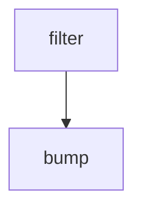

# bump-vm-images

Workflow definition for **bump-vm-images**. This page documents the checked-in GitHub Actions configuration; it does not assert that a run succeeds.

## At a glance

| | |
| --- | --- |
| Platform | GitHub Actions |
| Source | [`.github/workflows/bump-vm-images.yml`](../bump-vm-images.yml) |
| Trigger | workflow_dispatch; schedule (Runs on a schedule; see the workflow source for current timing) |

## Purpose

This workflow filters active branches and runs Updatecli against each selected branch. Its local configuration updates Buildkite VM image references; the workflow comments explain that the bump follows image availability.

## When it runs

- workflow_dispatch
- schedule (Runs on a schedule; see the workflow source for current timing)

Event and job filters are evaluated as shown in the workflow source.

## Execution flow

| Job | Runner | Condition | Depends on | Configured work |
| --- | --- | --- | --- | --- |
| `filter` | `ubuntu-slim` | `Always when its event is eligible` | None declared | `elastic/oblt-actions/elastic/active-branches@v1` |
| `bump` | `ubuntu-latest` | `Always when its event is eligible` | `filter` | `actions/checkout@v7`; `elastic/oblt-actions/updatecli/run@v1`; `elastic/oblt-actions/slack/send@v1` |

## Inputs, outputs, and access

| Item | Details |
| --- | --- |
| Inputs | No workflow inputs declared; environment names: BRANCH_NAME, GITHUB_TOKEN, JOB_URL |
| Outputs | filter.matrix; artifact/cache actions: none declared |
| Permissions | contents: read; filter.contents: read; bump.contents: write; bump.pull-requests: write |
| Secrets | GITHUB_TOKEN, SLACK_BOT_TOKEN |

## Operational notes

- filter timeout: 1 minutes
- bump uses a matrix/strategy declared in the source
- Exact schedule timing is intentionally omitted; consult the workflow source.

## Sources

- Workflow: [`.github/workflows/bump-vm-images.yml`](../bump-vm-images.yml)
- Updatecli configuration: [`.github/workflows/updatecli.d/values.d/scm.yml`](../../../.github/workflows/updatecli.d/values.d/scm.yml)
- Updatecli configuration: [`.github/workflows/updatecli.d/updatecli-bump-vm-images.yml`](../../../.github/workflows/updatecli.d/updatecli-bump-vm-images.yml)
- External action/workflow reference: `actions/checkout@v7` (implementation is outside this checkout).
- External action/workflow reference: `elastic/oblt-actions/elastic/active-branches@v1` (implementation is outside this checkout).
- External action/workflow reference: `elastic/oblt-actions/slack/send@v1` (implementation is outside this checkout).
- External action/workflow reference: `elastic/oblt-actions/updatecli/run@v1` (implementation is outside this checkout).
