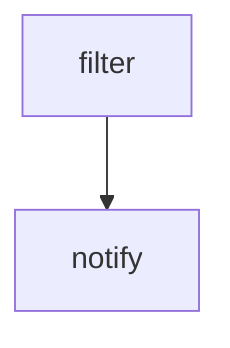

# notify-stalled-snapshots

Workflow definition for **notify-stalled-snapshots**. This page documents the checked-in GitHub Actions configuration; it does not assert that a run succeeds.

## At a glance

| | |
| --- | --- |
| Platform | GitHub Actions |
| Source | [`.github/workflows/notify-stalled-snapshots.yml`](../notify-stalled-snapshots.yml) |
| Trigger | workflow_dispatch; schedule (Runs on a schedule; see the workflow source for current timing) |

## Purpose

This workflow provides the `notify-stalled-snapshots` CI task: it prepares or invokes `elastic/oblt-actions/elastic/active-branches@v1`, `actions/checkout@v7`, `elastic/oblt-actions/slack/send@v1` and then runs `echo "date=$(date +%Y-%m-%d)" >> "${GITHUB_OUTPUT}"`, `if git --no-pager \`, `log --pretty=format: \`. The checked-in source does not state a separate motivation.

## When it runs

- workflow_dispatch
- schedule (Runs on a schedule; see the workflow source for current timing)

Event and job filters are evaluated as shown in the workflow source.

## Execution flow

| Job | Runner | Condition | Depends on | Configured work |
| --- | --- | --- | --- | --- |
| `filter` | `ubuntu-latest` | `Always when its event is eligible` | None declared | `elastic/oblt-actions/elastic/active-branches@v1` |
| `notify` | `ubuntu-latest` | `Always when its event is eligible` | `filter` | `actions/checkout@v7`; run echo "date=$(date +%Y-%m-%d)" >> "${GITHUB_OUTPUT}"; run if git --no-pager \   log --pretty=format: \     --name-only \     --since="7 days ago" \   \| grep …; `elastic/oblt-actions/slack/send@v1` |

## Inputs, outputs, and access

| Item | Details |
| --- | --- |
| Inputs | No workflow inputs declared; environment names: GH_TOKEN, URL_QUERY |
| Outputs | filter.matrix; artifact/cache actions: none declared |
| Permissions | contents: read |
| Secrets | SLACK_BOT_TOKEN |

## Operational notes

- filter timeout: 1 minutes
- notify uses a matrix/strategy declared in the source
- Exact schedule timing is intentionally omitted; consult the workflow source.

## Sources

- Workflow: [`.github/workflows/notify-stalled-snapshots.yml`](../notify-stalled-snapshots.yml)
- External action/workflow reference: `actions/checkout@v7` (implementation is outside this checkout).
- External action/workflow reference: `elastic/oblt-actions/elastic/active-branches@v1` (implementation is outside this checkout).
- External action/workflow reference: `elastic/oblt-actions/slack/send@v1` (implementation is outside this checkout).
